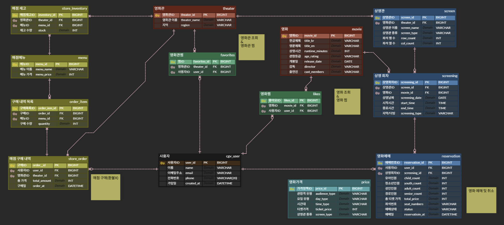
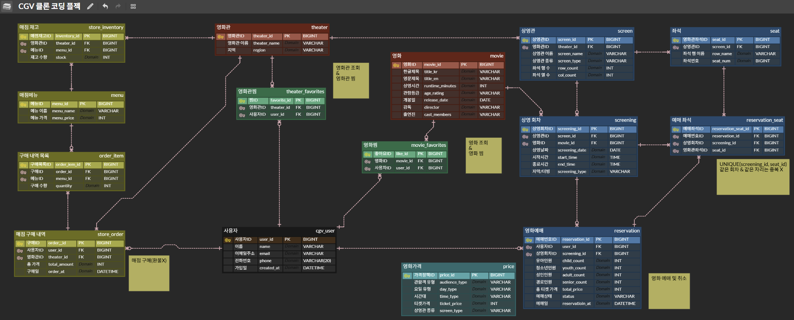

# spring-cgv-24th
CEOS 24기 백엔드 스터디 - CGV 클론 코딩 프로젝트

[CGV-API 명세서](https://app.notion.com/p/CGV-CLONE-Project-API-400de222d8e48038ba4cfedc75e00427?source=copy_link)

# 🎬 CGV Clone Project

CGV 서비스를 참고하여 영화 조회, 극장 및 상영 정보 조회, 영화 예매, 매점 주문, 영화/극장 찜 기능을 구현하는 Spring Boot 프로젝트입니다.

이번 과제에서는 실제 서비스를 구현하기 전에 서비스에서 필요한 데이터를 분석하여 **ERD를 설계**하고, 이를 바탕으로 **JPA Entity와 Repository 계층**을 구현했습니다.

---

# 1. CGV 서비스 분석 및 ERD 설계

## 1-1. 서비스에서 필요한 데이터

CGV 서비스를 구성하기 위해 크게 다음과 같은 데이터를 관리해야 한다고 판단했습니다.

| 도메인             | 필요한 데이터                               |
|-----------------|---------------------------------------|
| cgv_user        | 사용자 이름, 이메일, 전화번호, 가입일                |
| movie           | 영화 제목, 감독, 출연진, 러닝타임, 개봉일, 관람 등급      |
| theater         | 극장명, 지역 및 극장 정보                       |
| screen          | 상영관 이름, 상영관 종류, 좌석 행/열                |
| screening       | 상영 영화, 상영관, 상영 날짜, 시작/종료 시간, 자막/더빙 여부 |
| reservation     | 예매 사용자, 상영 회차, 좌석, 인원, 총 가격, 예매 상태    |
| price           | 관람객 종류, 요일, 상영관 종류, 시간대에 따른 가격        |
| store_inventory | 메뉴, 가격, 영화관별 재고                       |
| store_order     | 주문 사용자, 주문 극장, 주문 상품, 수량, 총 가격        |
| favorites       | 사용자가 찜한 영화관                           |
| likes           | 사용자가 찜한 영화                            |

서비스의 기능을 단순히 테이블 하나씩 대응시키기보다, **어떤 데이터가 독립적으로 존재하는지와 데이터가 어떤 관계를 가지는지**를 중심으로 ERD를 설계했습니다.

---

## 1-2. ERD

> 아래 부분에 최종 ERD 이미지를 첨부합니다.

```md

```

는 다음과 같습니다.

```text
User
 ├── Reservation ── Screening ── Movie
 │                       │
 │                     Screen
 │                       │
 │                    Theater
 │
 ├── StoreOrder ── OrderItem ── Menu
 │        │
 │     Theater
 │
 ├── Favorites ── Theater
 │
 └── Likes ── Movie

Theater
 └── StoreInventory ── Menu
```

---

## 1-3. Entity 설명

### `User`

CGV 서비스를 이용하는 회원 정보를 관리합니다.

예매, 매점 주문, 영화 좋아요, 영화관 찜 등 대부분의 사용자 활동의 기준이 되는 Entity입니다.

사용자 한 명은 여러 개의 예매, 주문, 찜 정보를 가질 수 있습니다.

---

### `Movie`

영화 자체의 고유한 정보를 관리합니다.

영화 제목, 감독, 출연진, 러닝타임, 개봉일, 관람 등급 등의 정보를 가집니다.

영화 자체의 정보와 실제 상영 정보는 다르기 때문에 `Screening`과 분리했습니다.

예를 들어 하나의 영화가 여러 극장, 여러 상영관, 여러 시간대에 상영될 수 있으므로 다음과 같은 관계를 가집니다.

```text
Movie 1 : N Screening
```

---

### `Theater`

실제 CGV 극장 정보를 관리합니다.

하나의 극장에는 여러 개의 상영관이 존재할 수 있기 때문에 `Screen`과 1:N 관계를 가집니다.

```text
Theater 1 : N Screen
```

또한 극장마다 매점 상품의 재고가 다를 수 있으므로 `StoreInventory`와도 연결됩니다.

---

### `Screen`

극장 내부에 존재하는 **물리적인 상영관**을 의미합니다.

예를 들어 `1관`, `2관`, `IMAX관`과 같은 공간 자체를 표현합니다.

주요 정보는 다음과 같습니다.

* 상영관 이름
* 상영관 종류
* 좌석 행 수
* 좌석 열 수

하나의 상영관에서는 시간에 따라 여러 영화가 상영될 수 있기 때문에 실제 영화 상영 일정은 `Screening`에서 관리합니다.

```text
Theater 1 : N Screen
Screen 1 : N Screening
```

---

### `Screening`

특정 영화가 특정 상영관에서 **언제 상영되는지**를 나타내는 Entity입니다.

다음과 같은 정보를 관리합니다.

* Movie
* Screen
* 상영 날짜
* 시작 시간
* 종료 시간
* 자막 / 더빙 여부

즉,

```text
Movie + Screen + Date + Time
```

의 조합이 하나의 상영 회차가 됩니다.

영화 자체의 정보와 상영 일정을 분리함으로써 같은 영화가 여러 극장과 시간대에서 상영되는 구조를 표현할 수 있도록 설계했습니다.

---

### `Reservation`

사용자의 영화 예매 정보를 관리합니다.

다음과 같은 정보를 가집니다.

* 예매한 사용자
* 상영 회차
* 좌석 번호
* 성인 / 청소년 / 어린이 / 경로 인원
* 총 결제 금액
* 예매 시간
* 예매 상태

예매는 특정 영화 자체가 아니라 **특정 시간에 진행되는 상영 회차**에 대해 발생하기 때문에 `Movie`가 아닌 `Screening`과 연결했습니다.

```text
User 1 : N Reservation
Screening 1 : N Reservation
```

---

### `Price`

영화 티켓 가격 정책을 표현하기 위한 Entity입니다.

CGV의 영화 가격은 하나의 값으로 결정되는 것이 아니라 여러 조건에 따라 달라질 수 있다고 판단했습니다.

예를 들어 다음과 같은 조건을 가집니다.

* 관람객 유형
* 평일 / 주말
* 일반관 / 특별관
* 시간대

따라서 가격 자체를 `Reservation`에 고정값으로 정의하기보다는 별도의 `Price` 구조로 분리했습니다.

---

### `Menu`

매점에서 판매되는 상품 자체를 관리합니다.

예를 들어 팝콘, 콜라 등의 상품명과 기본 가격을 저장합니다.

메뉴 자체의 정보와 특정 극장의 재고는 다른 개념이기 때문에 재고는 `StoreInventory`에서 별도로 관리합니다.

---

### `StoreInventory`

각 극장이 가지고 있는 매점 상품의 재고를 관리합니다.

처음에는 `Menu` 자체에 재고를 저장하는 방법도 생각했지만, 동일한 팝콘 상품이라도 강남점과 신촌점의 재고는 서로 다를 수 있습니다.

따라서 다음과 같이 분리했습니다.

```text
Theater + Menu → StoreInventory
```

이를 통해 **같은 메뉴를 여러 극장에서 공유하면서 극장별 재고는 독립적으로 관리**할 수 있습니다.

`stock`은 실제 판매 가능한 재고를 의미하며 도메인에서 유효한 재고 값이 유지되도록 관리합니다.

---

### `StoreOrder`

사용자가 특정 영화관의 매점에서 생성한 주문을 관리합니다.

다음과 같은 정보를 가집니다.

* 주문 사용자
* 주문 극장
* 주문 시간
* 총 주문 금액

한 번의 주문으로 여러 개의 상품을 구매할 수 있기 때문에 상품 정보를 직접 저장하지 않고 `OrderItem`으로 분리했습니다.

---

### `OrderItem`

하나의 주문에 포함되는 개별 상품을 관리합니다.

```text
StoreOrder 1 : N OrderItem
```

예를 들어

```text
주문 #1
├── 팝콘 × 1
├── 콜라 × 2
└── 핫도그 × 1
```

과 같은 주문을 표현할 수 있습니다.

---

### `Favorites`

사용자가 자주 이용하는 영화관을 찜하는 정보를 관리합니다.

```text
User N : M Theater
```

의 관계를 직접 표현하는 대신 연결 Entity인 `Favorites`를 사용했습니다.

---

### `Likes`

사용자가 관심 있는 영화를 좋아요한 정보를 관리합니다.

처음에는 영화관 찜 기능만 생각했지만 서비스 기능을 분석하면서 **영화 자체에 대한 좋아요 기능도 별도의 관계가 필요하다**고 판단했습니다.

따라서

```text
Favorites → User ↔ Theater
Likes     → User ↔ Movie
```

로 역할을 분리했습니다.

---

# 2. ERD를 작성하면서 겪은 시행착오

ERD를 처음 작성할 때는 필요한 데이터를 테이블로 옮기는 것에 집중했습니다.

하지만 실제 기능을 하나씩 생각해보면서 **"데이터가 무엇인가"보다 "각 데이터가 어떤 책임을 가지는가"가 더 중요하다는 점**을 알게 되었습니다.

## 2-1. `Screen`과 `Screening`의 구분

초기에는 상영관과 영화 상영 정보를 하나의 개념으로 생각했습니다.

하지만 `Screen`은 극장 내부에 실제로 존재하는 공간이고 `Screening`은 그 공간에서 특정 시간에 진행되는 영화 상영이라는 차이가 있습니다.

예를 들어 `CGV 신촌 1관`이라는 상영관은 계속 존재하지만,

```text
10:00 영화 A
13:00 영화 B
16:00 영화 A
```

와 같이 상영 일정은 계속 변경됩니다.

따라서

```text
Theater → Screen → Screening ← Movie
```

구조로 분리했습니다.

이를 통해 물리적인 상영관 정보가 상영 회차마다 반복 저장되는 것을 방지할 수 있었습니다.

---

## 2-2. 자막/더빙 정보는 Movie가 아닌 Screening에 저장

처음에는 자막/더빙 여부를 영화 정보로 생각할 수도 있었습니다.

하지만 같은 영화라도

```text
10:00 자막
13:00 더빙
```

처럼 상영 회차에 따라 형식이 달라질 수 있습니다.

따라서 자막/더빙 정보는 `Movie`가 아니라 `Screening`의 속성으로 관리했습니다.

이 과정을 통해 **값이 어느 Entity에 속해야 하는지는 값 자체보다 값이 언제 변화하는지를 기준으로 판단해야 한다**는 것을 알게 되었습니다.

---

## 2-3. 같은 Enum을 사용한다고 Entity 관계가 생기는 것은 아니다

`Screen`에서는 상영관 종류를 구분하기 위해 `ScreenType`을 사용하고, 가격을 계산할 때도 상영관 종류가 필요합니다.

처음에는 같은 종류 정보를 사용하므로 `Screen`과 `Price` 테이블을 직접 연결해야 하는지 고민했습니다.

하지만 두 Entity가 단순히 동일한 Enum 값을 사용한다는 것과 DB상의 관계를 가지는 것은 다른 문제라고 판단했습니다.

`ScreenType`은 두 Entity에서 사용되는 **공통된 값의 종류**일 뿐이므로 이를 이유로 불필요한 FK 관계를 추가하지 않았습니다.

---

## 2-4. 한 번의 예매에서 여러 좌석을 선택할 수 있음

초기 ERD에서는 좌석 번호 하나만 생각했지만 실제 예매에서는

```text
H12, H13
```

과 같이 한 번의 예매에서 여러 좌석을 선택할 수 있습니다.

따라서 예매 데이터는 단순히 하나의 좌석 번호만 존재한다고 가정하면 안 된다는 점을 알게 되었습니다.

현재 프로젝트 범위에서는 `Reservation`에서 선택한 좌석 정보를 관리하도록 구현했으며, 추후 좌석별 상태 관리나 동시 예매까지 구현한다면 `Seat` 또는 `ReservationSeat` Entity로 분리할 수 있습니다.

---

## 2-5. 메뉴와 매점 재고 분리

처음에는 메뉴 Entity에 상품 재고까지 저장하는 구조를 생각했습니다.

하지만 메뉴 자체는 여러 영화관에서 공통으로 판매할 수 있는 반면 재고는 영화관별로 달라집니다.

예를 들어 동일한 `고소팝콘`이라도

```text
CGV A점 → 10개
CGV B점 → 3개
```

가 될 수 있습니다.

따라서

```text
Menu
Theater
   ↓
StoreInventory
```

구조로 변경했습니다.

이를 통해 상품 정보와 영화관별 재고 정보를 분리할 수 있었습니다.

---

## 2-6. 주문과 주문 상품 분리

하나의 주문에는 여러 상품이 포함될 수 있습니다.

처음부터 모든 상품을 `StoreOrder` 하나에 저장하면 상품 수가 늘어날수록 구조가 복잡해집니다.

따라서

```text
StoreOrder 1 : N OrderItem
```

관계로 분리했습니다.

`StoreOrder`는 주문 자체를 의미하고, `OrderItem`은 주문에 포함된 각각의 상품과 수량을 의미합니다.

---

## 2-7. 영화관 찜과 영화 좋아요 분리

처음에는 영화관을 찜하는 기능을 중심으로 Favorite 관련 Entity를 설계했습니다.

하지만 기능을 다시 분석하면서 사용자는 영화관뿐만 아니라 영화에도 관심 표시를 할 수 있다는 점을 발견했습니다.

두 기능은 대상이 서로 다르기 때문에 하나의 Favorite 테이블에서 모두 처리하기보다 역할을 분리했습니다.

```text
Favorites → User + Theater
Likes     → User + Movie
```

이를 통해 각 관계의 의미가 더 명확해졌습니다.

---

## 2-8. ENUM과 데이터 타입 결정

ERD를 처음 작성하면서 `VARCHAR`, `INT`, `BIGINT`, `ENUM` 등을 어떤 기준으로 선택해야 하는지도 고민했습니다.

PK는 데이터가 지속적으로 증가할 수 있다는 점과 JPA Entity ID 타입을 고려하여 주로 `BIGINT`를 사용했습니다.

반면 다음처럼 선택 가능한 값이 명확하게 정해져 있는 데이터는 Enum으로 표현했습니다.

```text
AgeRating
ScreenType
ScreeningType
ReservationStatus
```

예를 들어 영화 관람 등급은 임의의 문자열을 입력받는 값이 아니라 정해진 값 중 하나이기 때문에 문자열로 직접 관리하는 것보다 Enum으로 관리하는 것이 안전하다고 판단했습니다.

---

# 3. Domain / Repository 계층 구현

ERD 설계를 바탕으로 JPA Entity와 Repository 계층을 구현했습니다.

## 3-1. Domain의 역할

Domain은 단순히 DB 테이블을 Java 클래스로 옮기는 것이 아니라 **서비스에서 사용하는 데이터의 구조와 의미를 표현하는 계층**이라고 생각했습니다.

예를 들어

```java
Movie
Theater
Screen
Screening
Reservation
```

등의 Entity는 각각 자신의 데이터를 가지고 있으며 Entity 간의 관계를 통해 CGV 서비스의 구조를 표현합니다.

즉,

> **Domain은 데이터의 구조와 의미를 정의한다.**

---

## 3-2. Repository의 역할

Repository는 Domain Entity를 실제 DB에 저장하거나 조회하기 위한 계층입니다.

이번 프로젝트에서는 Spring Data JPA의 `JpaRepository`를 사용했습니다.

```java
public interface MovieRepository extends JpaRepository<Movie, Long> {
}
```

`JpaRepository`를 상속하면 기본적으로 다음과 같은 CRUD 기능을 사용할 수 있습니다.

```java
save()
findById()
findAll()
delete()
deleteById()
```

따라서 반복적인 CRUD SQL을 직접 작성하지 않고 Entity 중심으로 데이터에 접근할 수 있습니다.

> **Repository는 Domain Entity를 DB에 저장하고 조회하는 역할을 한다.**

---

## 3-3. User Entity 구현

서비스의 대부분의 기능은 사용자를 기준으로 동작하기 때문에 `User` Entity를 구현했습니다.

```text
User
 ├── Reservation
 ├── StoreOrder
 ├── Favorites
 └── Likes
```

사용자는 영화 예매와 매점 주문을 할 수 있고, 영화관을 찜하거나 영화에 좋아요를 남길 수 있습니다.

따라서 User는 여러 도메인과 관계를 가지는 핵심 Entity 중 하나입니다.

---

## 3-4. 도메인을 나눈 기준

처음에는 단순히 Entity마다 패키지를 만드는 방법도 생각했지만, 관련된 Entity를 기능 단위로 묶는 것이 구조를 이해하기 쉽다고 판단했습니다.

최종적으로 다음과 같이 도메인을 구분했습니다.

```text
user
└── User

movie
├── Movie
└── AgeRating

theater
├── Theater
├── Screen
├── Screening
├── ScreenType
└── ScreeningType

reservation
├── Reservation
├── Price
└── Reservation 관련 Enum

shop
├── Menu
├── StoreInventory
├── StoreOrder
└── OrderItem

favorite / like
├── Favorites
└── Likes
```

### `movie`

영화 자체의 정보를 담당합니다.

### `theater`

극장, 물리적 상영관, 상영 회차처럼 **영화가 실제로 상영되는 공간과 일정**을 담당합니다.

### `reservation`

특정 상영 회차에 대한 사용자 예매와 가격 정보를 담당합니다.

### `shop`

매점 상품, 극장별 재고, 주문과 주문 상품처럼 **매점 구매 흐름**을 담당합니다.

### `favorite / like`

User와 Movie 또는 Theater 사이의 관심 관계를 담당합니다.

이처럼 단순히 테이블 개수를 기준으로 나눈 것이 아니라 **같은 기능 흐름에서 함께 변경되고 사용되는 Entity들을 하나의 도메인으로 묶는 것**을 기준으로 패키지를 구성했습니다.

---

## 3-5. 모든 Entity에 Repository가 필요한가?

처음에는

> "Entity를 만들었으면 Repository도 모두 만들어야 하는 것 아닌가?"

라고 생각했습니다.

하지만 Repository는 Entity가 존재한다는 이유만으로 반드시 만들어야 하는 것은 아니라고 판단했습니다.

Repository 작성 여부를 결정할 때 다음 기준을 사용했습니다.

> **이 객체를 애플리케이션에서 독립적인 조회·저장 단위로 다룰 필요가 있는가?**

예를 들어 `Movie`, `Theater`, `Screening`처럼 서비스에서 직접 조회하거나 저장해야 하는 데이터라면 Repository가 필요합니다.

```java
public interface MovieRepository
        extends JpaRepository<Movie, Long> {
}
```

반면 현재 구현 범위에서 독립적인 CRUD가 필요하지 않고 다른 도메인의 로직 안에서만 사용되는 객체라면 별도의 Repository를 만들지 않았습니다.

### Price의 경우

`Price`는 영화 예매 금액을 결정하기 위한 가격 정책을 표현합니다.

현재 프로젝트에서는 가격 자체를 별도의 기능으로 등록·수정·삭제하는 기능을 제공하는 것이 목적이 아니라 **예매 가격을 결정하기 위한 데이터**로 사용하기 때문에 별도의 Repository를 두지 않았습니다.

즉,

```text
Entity 존재 여부
        ≠
Repository 필요 여부
```

이며 Repository는 실제 애플리케이션에서 해당 데이터를 어떻게 사용할지를 기준으로 결정했습니다.

---

# 4. ERD와 Domain을 설계하며 배운 점

이번 과제를 진행하면서 ERD는 단순히 필요한 테이블을 나열하는 작업이 아니라는 것을 알게 되었습니다.

처음에는 CGV 화면에서 보이는 정보를 그대로 테이블로 만들려고 했지만, 기능을 하나씩 생각하면서 데이터의 의미와 변경 주기가 서로 다르다는 것을 확인했습니다.

특히

```text
Screen과 Screening의 분리
Menu와 StoreInventory의 분리
StoreOrder와 OrderItem의 분리
Favorites와 Likes의 분리
```

과정을 거치면서 **비슷해 보이는 데이터라도 역할과 생명주기가 다르면 별도의 Entity로 나누어야 한다는 점**을 배웠습니다.

또한 같은 Enum을 사용한다는 이유만으로 Entity 사이에 관계를 만들거나, Entity가 존재한다는 이유만으로 Repository를 만드는 것이 아니라

> **실제 서비스에서 데이터가 어떻게 생성되고, 조회되고, 변경되는가**

를 먼저 생각해야 한다는 점을 알게 되었습니다.

이번 ERD 설계와 JPA Entity 구현을 통해 단순한 테이블 설계를 넘어 **서비스의 요구사항을 데이터 모델로 표현하는 과정**을 경험할 수 있었습니다.


[2주차 실습 정리](https://www.notion.so/CEOS-2-3dade222d8e480a29f3fd1494b1cb96e?source=copy_link)

---
# 📝2주차 코드 피드백 및 개선사항
ERD 수정
```md

```

### 1. 예외 처리 방식 통일

기존에는 도메인마다 예외를 처리하는 방식이 달라질 수 있었기 때문에,
`GlobalException`, `ErrorCode`, `GlobalExceptionHandler`를 활용하여 예외 처리 방식을 통일했습니다.

```text
TheaterService
    ↓
GlobalException 발생
    ↓
ErrorCode.THEATER_NOT_FOUND
    ↓
GlobalExceptionHandler
    ↓
ErrorResponse 생성
    ↓
HTTP 404 응답
```

Service에서는 상황에 맞는 `ErrorCode`를 담아 `GlobalException`을 발생시키고,
`GlobalExceptionHandler`가 이를 공통으로 처리하여 `ErrorResponse`를 반환하도록 구성했습니다.

이를 통해 각 Controller나 Service에서 직접 HTTP 응답을 생성하지 않고,
애플리케이션 전체에서 일관된 형식으로 예외를 처리할 수 있도록 개선했습니다.

---

### 2. 재고 추가 API에서 `@RequestParam` 활용

영화관 매점의 특정 재고 수량을 추가하는 API를 구현했습니다.

```http
PATCH /api/shop/1/inventories/3/addStock?quantity=10
```

처리 흐름은 다음과 같습니다.

```text
PATCH 요청
    ↓
Controller
quantity = 10
    ↓
ShopService.addStock(1, 3, 10)
    ↓
StoreInventory.increaseStock(10)
    ↓
기존 stock 20
    ↓
stock 30
```

재고 수량이라는 하나의 단순한 값만 전달하기 때문에 별도의 Request DTO를 추가하지 않고
`@RequestParam`을 사용하여 요청 값을 전달하도록 구현했습니다.

이를 통해 모든 요청에 DTO가 반드시 필요한 것은 아니며,
요청 데이터의 구조와 복잡도에 따라 적절한 전달 방식을 선택할 수 있다는 점을 학습했습니다.

---

### 3. Entity가 생성 책임을 가지도록 개선

기존 영화관 등록 코드에서는 Request DTO가 Entity의 생성 방법까지 알고 있었습니다.

피드백을 반영하여 DTO는 **요청 데이터를 전달하는 역할**에 집중하고,
Entity가 자신의 생성 규칙을 직접 관리하도록 수정했습니다.

```text
기존

RequestDTO
 ├─ 요청 데이터 전달
 └─ Entity 생성 규칙까지 알고 있음


개선

RequestDTO
 └─ 요청 데이터 전달
          ↓
Theater.create(...)
          ↓
Theater가 자신의 생성 규칙 관리
```

이를 통해 객체 생성에 대한 책임을 Entity 내부로 이동시키고,
Request DTO와 Entity의 역할을 명확하게 분리했습니다.

---

### 4. 좌석과 예약된 좌석 분리

처음에는 예매 정보에서 좌석 번호를 직접 관리했지만,
좌석 자체의 정보와 실제 예매된 좌석을 구분하기 위해 테이블 구조를 개선했습니다.

- `seat` : 영화관 상영관별 실제 좌석 정보
- `reservation_seat` : 특정 예매에 할당된 좌석 정보

```text
Screen
  │
  └── Seat
        │
        └── ReservationSeat
                │
                └── Reservation
```

이를 통해 **존재하는 좌석**과 **현재 예매에 할당된 좌석**의 역할을 분리했습니다.

또한 예매 취소 과정에서 두 데이터의 처리 방식에도 차이가 있습니다.

- `Reservation` : 데이터를 바로 삭제하는 대신 예매 상태를 `CANCELED`로 변경
- `ReservationSeat` : 예매 취소 시 해당 좌석의 할당 정보를 제거

즉, 예매 기록은 상태값을 통해 남겨두면서 실제 좌석은 다시 예약할 수 있도록 처리했습니다.

---

### 5. 비관적 락을 이용한 좌석 동시성 처리

같은 좌석에 여러 사용자가 동시에 예매 요청을 보내는 상황에서는
좌석 중복 예약이 발생할 가능성이 있습니다.

이를 방지하기 위해 비관적 락(`PESSIMISTIC_WRITE`)을 적용했습니다.

비관적 락은 데이터 충돌이 발생할 것이라고 가정하고,
데이터를 조회하는 시점부터 Lock을 걸어 다른 트랜잭션의 수정을 제한하는 방식입니다.

```java
@Lock(LockModeType.PESSIMISTIC_WRITE)
@Query("""
        select s
        from Screening s
        where s.screeningId = :screeningId
        """)
Optional<Screening> findByIdWithLock(
        @Param("screeningId") Long screeningId
);
```

해당 메서드는 `screeningId`에 해당하는 `Screening`을 조회하면서
DB에 `SELECT ... FOR UPDATE`에 해당하는 락을 걸도록 구성했습니다.

```text
사용자 A                    사용자 B
   │                           │
   │ Screening 조회 + Lock     │
   ▼                           │
좌석 예매 처리                  │ 대기
   │                           │
Transaction 종료               │
   │                           ▼
   └──── Lock 해제 ───────→ 이후 처리
```

이를 통해 같은 상영 회차의 좌석 예매 로직이 동시에 실행되면서
중복 예약이 발생하는 상황을 방지하고자 했습니다.

---

### 6. `saveAll()` → `saveAllAndFlush()` 변경

예약 좌석을 저장할 때 `saveAll()` 대신 `saveAllAndFlush()`를 사용하도록 수정했습니다.

```java
reservationSeatRepository.saveAllAndFlush(reservationSeats);
```

좌석 중복 방지를 위해 DB의 `UNIQUE` 제약 조건을 사용하는 경우,
실제 SQL 실행 시점에 제약 조건 위반이 확인됩니다.

따라서 저장 후 즉시 `flush`하여 SQL을 DB에 반영하도록 하고,
`UNIQUE` 제약 조건 위반이 발생한다면 해당 시점에서 확인할 수 있도록 변경했습니다.


---

[3주차 실습 정리](https://app.notion.com/p/CEOS-3-3e5de222d8e48099a302fc1397cf944c?source=copy_link)

# 5. JWT 를 이용한 인증 흐름

## 5-1. JWT의 Header, Payload, Signature 각각의 역할

JWT(JSON Web Token)는 `Header.Payload.Signature` 세 부분으로 구성됩니다.

| 구성 | 역할 |
| --- | --- |
| Header | 토큰 타입과 서명에 사용하는 알고리즘 정보를 저장 |
| Payload | 사용자 정보, 만료 시간 등의 Claim을 저장 |
| Signature | 토큰이 서버에서 발급되었는지, 변조되지 않았는지 검증 |

#### Header
JWT가 어떤 방식으로 서명되었는지에 대한 알고리즘 정보를 담습니다.

#### Payload
JWT에 전달하고 싶은 정보를 `Claim` 형태로 저장합니다.
예를 들어 `userId`, 발급 시간, 만료 시간 등을 저장할 수 있습니다.

> Payload는 암호화되어 숨겨지는 영역이 아니므로 비밀번호와 같은 민감한 정보는 저장하지 않습니다.

#### Signature
JWT가 서버에서 발급된 토큰인지, 전달 과정에서 변조되지 않았는지를 확인하기 위한 서명입니다.

서버의 Secret Key를 이용해 Signature를 생성하기 때문에 Payload를 임의로 변경하거나 다른 Secret Key로 JWT를 생성하면 검증에 실패합니다.

---

## 5-2. Access Token과 Refresh Token 차이

JWT 인증에서는 Access Token과 Refresh Token을 함께 사용할 수 있습니다.

| 구분 | Access Token | Refresh Token |
| --- | --- | --- |
| 역할 | API 접근 및 사용자 인증 | Access Token 재발급 |
| 유효 기간 | 비교적 짧음 | 비교적 긺 |
| 사용 시점 | API 요청 시 | Access Token 만료 후 재발급 시 |

Access Token의 유효 기간을 짧게 설정하면 토큰이 탈취되었을 때 사용할 수 있는 시간을 제한할 수 있습니다.

Refresh Token은 Access Token이 만료되었을 때 새로운 Access Token을 발급받는 데 사용합니다.

현재 CGV 프로젝트에서는 **Access Token을 이용한 인증을 구현**했습니다.

---

### 3. Cookie & Session & JWT의 역할

HTTP는 기본적으로 이전 요청의 로그인 상태를 스스로 기억하지 못하는 **무상태성 한계**를 가집니다.

따라서 사용자를 지속적으로 식별하기 위한 방법이 필요합니다.
> Cookie : 브라우저가 정보를 저장하고 이후 요청에 전달하는 역할

| 구분 | 역할 |
| --- | --- |
| Session | 서버가 사용자의 로그인 상태를 기억하여 저장 |
| JWT | 사용자 인증 정보를 토큰에 담아 전달 |

#### Session 기반 인증

```text
Client
  ↓
Cookie에 Session ID 저장
  ↓
Server
  ↓
Session 저장소 조회
  ↓
사용자 식별
```

#### JWT 기반 인증

CGV 프로젝트에서는 세션에 로그인 상태를 저장하지 않고 클라이언트가 매 요청마다 Access Token을 전달하도록 구현했습니다.

```http
Authorization: Bearer <access-token>
```

또한 다음과 같이 `STATELESS` 정책을 적용했습니다.

```java
.sessionManagement(session ->
        session.sessionCreationPolicy(SessionCreationPolicy.STATELESS)
)
```

따라서 서버가 이전 요청의 인증 상태를 세션에 저장하지 않고, **각 요청마다 JWT를 검증하여 사용자를 인증**합니다.

---

## 5-4. 인증(Authentication)과 인가(Authorization)

### 인증 (Authentication)

> **"현재 요청을 보낸 사용자가 누구인가?"**

사용자의 신원을 확인하는 과정입니다.

CGV 프로젝트에서는 로그인할 때 이메일과 비밀번호를 검증하고, 이후 요청에서는 JWT를 검증하여 사용자를 인증합니다.

#### 401 Unauthorized(인증되지 않음)
클라이언트가 **로그인 등 올바른 인증 정보가 없어** 요청이 거부된 상태

- 원인 : 로그인을 하지 않았거나, 만료된 토큰을 사용했거나, 잘못된 비밀번호를 입력한 경우 발생
- 해결 : 로그인을 다시 하거나 유효한 인증 토큰을 첨부해 재요청

### 인가 (Authorization)

> **"인증된 사용자가 해당 기능을 사용할 권한이 있는가?"**

인증된 사용자의 권한을 확인하는 과정입니다.

예를 들어 관리자 API는 다음과 같이 제한했습니다.

```java
.requestMatchers("/api/admin/**").hasRole("ADMIN")
```

따라서 정상적인 JWT를 가지고 있더라도 `ADMIN` 권한이 없다면 관리자 API에 접근할 수 없습니다.

#### 403 Forbidden(권한이 없음)
서버가 클라이언트의 **신원을 확인(인증)했으나, 해당 리소스에 접근할 권한이 없는** 상태

- 원인 : 일반 사용자가 관리자 전용 페이제이 접속하려고 할 때처럼, 로그인한 사용자의 등급이나 권한이 부족한 경우 발생
- 해결 : 로그인을 다시 해도 권한이 바뀌지 않는 한 해결되지 않으며, 관리자에게 권한을 요청해야 함

---

## 5-5. JWT 검증 결과가 Authentication 와 SecurityContext로 어떻게 연결될까?

JWT를 검증한 이후에는 검증된 사용자 정보를 Spring Security가 이해할 수 있는 `Authentication` 객체로 변환해야 합니다.

CGV 프로젝트에서는 `JwtAuthenticationFilter`가 이 역할을 담당합니다.

```text
HTTP Request
      ↓
Authorization: Bearer <JWT>
      ↓
JwtAuthenticationFilter
      ↓
JWT 검증
      ↓
userId 추출
      ↓
CustomUserDetails 조회
      ↓
Authentication 생성
      ↓
SecurityContext 저장
      ↓
인가 검사
      ↓
Controller
```

JWT 검증에 성공하면 `UsernamePasswordAuthenticationToken`을 생성합니다.

```java
UsernamePasswordAuthenticationToken authentication =
        new UsernamePasswordAuthenticationToken(
                userDetails,
                null,
                userDetails.getAuthorities()
        );
```

각 값의 의미는 다음과 같습니다.

- `principal` : 인증된 사용자인 `CustomUserDetails`
- `credentials` : JWT 검증이 완료되었으므로 `null`
- `authorities` : 사용자가 가진 권한

생성된 `Authentication` 객체는 `SecurityContext`에 저장합니다.

```java
SecurityContext context =
        SecurityContextHolder.createEmptyContext();

context.setAuthentication(authentication);

SecurityContextHolder.setContext(context);
```

이후 Spring Security는 `SecurityContext`에 저장된 인증 정보를 이용하여 현재 사용자가 누구인지 확인하고 접근 권한을 판단합니다.

Controller에서는 다음과 같이 현재 인증된 사용자 정보를 사용할 수 있습니다.

```java
@AuthenticationPrincipal CustomUserDetails userDetails
```

이를 통해 Controller에서 JWT를 다시 직접 파싱하지 않고 현재 로그인 사용자의 `userId`를 사용할 수 있습니다.

---

## 5-6. JWT 인증 흐름
> JwtUtil -> JwtFilter -> Security/FilterConfig

#### JwtUtil 
토큰을 생성하고, 읽고, 검증하는 "엔진 핵심 클래스"

#### JwtFilter
요청이 Controller에 도착하기 전, 토큰을 검사하는 "감시자"

#### Security/FilterConfig
JwtFilter가 실제 요청 앞에서 실행되도록 "등록"하는 설정 파일


### 🔐 CGV JWT 인증 흐름

```text
Client
  │
  │ Authorization: Bearer <Access Token>
  ▼
JwtAuthenticationFilter
  │
  ├── 토큰 없음
  │      └── 보호 API → 401 TOKEN_NOT_EXIST
  │
  ├── 만료된 토큰
  │      └── 401 TOKEN_EXPIRED
  │
  ├── 유효하지 않은 토큰
  │      └── 401 TOKEN_INVALID
  │
  └── 정상 JWT
          │
          ▼
       userId 추출
          │
          ▼
   CustomUserDetails 조회
          │
          ▼
   Authentication 생성
          │
          ▼
   SecurityContext 저장
          │
          ▼
       인가 검사
       /        \
    권한 O      권한 X
      │           │
      ▼           ▼
 Controller   403 ACCESS_DENIED
```

JWT를 단순히 발급하고 검증하는 것에서 끝나는 것이 아니라, 검증된 사용자 정보를 Spring Security의 `Authentication`으로 변환하여 `SecurityContext`에 저장하고 이를 기반으로 인증과 인가가 이루어지도록 구성했습니다.

---

## 5-7. CGV 프로젝트의 Access Token에는 어떤 Claim이 필요한가요?

CGV 프로젝트에서 Access Token의 가장 중요한 목적은 **현재 요청을 보낸 사용자가 누구인지 식별하는 것**입니다.

현재 Access Token에는 다음 Claim을 사용합니다.

| Claim | 역할 |
| --- | --- |
| `sub` | 로그인 사용자의 `userId` |
| `iat` | Access Token 발급 시간 |
| `exp` | Access Token 만료 시간 |

Access Token을 생성할 때 `userId`를 `subject`에 저장합니다.

```java
return Jwts.builder()
        .subject(String.valueOf(userId))
        .issuedAt(now)
        .expiration(expiration)
        .signWith(secretKey)
        .compact();
```

JWT 인증 시에는 `subject`에서 `userId`를 추출합니다.

```text
JWT
 ↓
subject(userId)
 ↓
CustomUserDetailsService.loadUserById(userId)
 ↓
사용자 조회
```

`movieId`, `reservationId`와 같은 값은 인증 정보가 아니라 요청마다 달라지는 리소스 정보이므로 JWT에 저장하지 않고 `PathVariable` 또는 `Request Body` 등을 통해 전달합니다.

> Q : 영화 ID나 예매 ID도 토큰에 넣어야 할까요?
> A : 영화 ID나 예매 ID는 사용자 인증 정보가 아니라 요청마다 달라지는 리소스 정보이므로 JWT에 저장하지 않고 PathVariable이나 Request Body를 통해 전달하는 것이 적절함.

---

CGV 프로젝트에서는 인증·인가 실패 상황을 다음과 같이 구분했습니다.

```text
토큰 없음
→ 401 TOKEN_NOT_EXIST

만료된 토큰
→ 401 TOKEN_EXPIRED

변조되거나 유효하지 않은 토큰
→ 401 TOKEN_INVALID

정상 JWT + 권한 부족
→ 403 ACCESS_DENIED
```

인증 실패는 `JwtAuthenticationEntryPoint`에서 처리하고, 인증은 되었지만 권한이 부족한 경우는 `JwtAccessDeniedHandler`에서 처리하도록 구현했습니다.

---

# 6. CSRF 설정

이번 JWT 인증에서는 `Authorization` 헤더를 통해 Access Token을 전달하며,
세션이나 인증 쿠키를 사용하지 않는다.

```http
Authorization: Bearer <access-token>


쿠키 기반 인증은 브라우저가 쿠키를 요청에 자동으로 포함하기 때문에
사용자의 의도와 관계없이 인증 정보가 포함된 요청이 전송될 수 있어 CSRF 공격을 고려해야 합니다.
반면 현재 구현에서는 클라이언트가 요청마다 직접 Authorization 헤더에 Bearer Token을 포함해야 하며, 브라우저가 인증 정보를 자동으로 전송하지 않습니다.
따라서 현재의 Stateless JWT 인증 구조에서는 CSRF 보호를 비활성화하였습니다.
```

---

# 7. 직접 구현하며  이해한 부분

- JWT 검증과 Spring Security의 인증 처리는 별개의 과정이라는 점
- `Authentication`이 현재 인증된 사용자와 권한 정보를 표현한다는 점
- `SecurityContext`를 통해 현재 요청의 인증 정보를 관리한다는 점
- `@AuthenticationPrincipal`을 통해 Controller에서 인증된 사용자를 가져올 수 있다는 점
- `SessionCreationPolicy.STATELESS`에서는 매 요청마다 JWT 인증이 필요하다는 점
- 인증 실패(`401`)와 권한 부족(`403`)을 구분해야 한다는 점
- JWT의 Payload에는 민감한 정보를 저장하면 안 된다는 점
- JWT에는 요청마다 달라지는 리소스 정보가 아닌 사용자 식별에 필요한 Claim을 저장해야 한다는 점

이번 구현을 통해 Spring Security를 단순히 설정 코드를 작성하는 방식으로 사용하는 것이 아니라,

> **요청이 Security Filter를 통과하면서 어떻게 사용자가 인증되고,  
> 인증된 사용자의 권한을 바탕으로 어떻게 접근이 제어되는지**

전체 흐름을 이해할 수 있었습니다.

앞으로 인증 기능을 구현할 때에도 단순히 로그인 성공 여부만 고려하는 것이 아니라
**토큰의 수명, 인증 상태 관리, 권한 검증, 예외 처리까지 하나의 인증 흐름으로 설계해야 한다는 점**을 배웠습니다.

---

# 📝 3주차 코드 피드백 및 개선사항

기존 CGV 프로젝트의 인증·인가와 좌석 예매 구조를 검토하면서, **요청의 소유권 검증**, **중복 좌석 점유 방지**, **결제 전후 상태 관리**가 중요하다는 점을 확인했습니다.

### 1. 관리자 API 분리 및 회원가입 입력값 검증

일반 사용자가 관리자 기능을 호출하지 못하도록 관리자 API를 별도로 분리하고, `SecurityConfig`에서 접근 권한을 설정했습니다.

```java
.requestMatchers("/api/admin/**").hasRole("ADMIN")
```

또한 `@EnableMethodSecurity`를 추가하여 필요한 경우 메서드 단위에서도 권한을 검증할 수 있도록 했습니다.

회원가입은 `SignupService`에 공통 로직을 두고 일반 회원과 관리자 회원의 생성 경로를 구분했습니다. **사용자가 요청 Body에서 관리자 권한을 직접 선택할 수 없도록** 역할은 서버에서 결정합니다.

로그인·회원가입 요청에서는 빈 문자열이나 잘못된 이메일 형식이 그대로 서비스 로직에 전달되지 않도록 Bean Validation을 적용했습니다.

| 필드 | 어노테이션 | 검증 내용 |
| --- | --- | --- |
| `email` | `@NotBlank` | 입력값 누락·공백 방지 |
| `email` | `@Email` | 이메일 형식 검증 |
| `password` | `@NotBlank` | 입력값 누락·공백 방지 |

Controller에는 `@Valid`를 적용했습니다.

중복 가입은 애플리케이션의 사전 조회뿐 아니라 **DB UNIQUE 제약조건**으로도 제한합니다. `saveAndFlush()`를 사용하면 지연된 INSERT로 인한 제약 위반을 트랜잭션 내부에서 확인하기 쉬워집니다. 단, 동시 가입 요청까지 정확히 분류하려면 DB 제약 위반 경로에 대한 별도 테스트가 필요합니다.

---

### 2. 본인 예매만 조회·취소하도록 개선

기존 예매 API에서 요청한 예매 ID만 확인하는 대신, 로그인한 사용자와 실제 예매 소유자가 일치하는지도 검증하도록 수정했습니다.

```java
@GetMapping("/{reservationId}")
public ResponseEntity<ReservationResponse> getReservation(
        @AuthenticationPrincipal CustomUserDetails userDetails,
        @PathVariable Long reservationId
) {
    return ResponseEntity.ok(
            reservationService.getReservation(
                    userDetails.getUserId(), reservationId
            )
    );
}
```

- 단건 조회: 로그인 사용자 ID와 예매 소유자 ID를 함께 검증
- 예매 취소: 단건 조회와 동일한 소유권 검증 정책 적용
- 목록 조회: **본인 예매 목록 조회 API** 추가

즉, JWT 인증에 성공했다는 사실만으로 모든 예매 데이터에 접근할 수 있는 것은 아닙니다. **인증(Authentication)** 이후에도 해당 예매의 소유자인지 확인하는 **인가(Authorization)** 과정이 필요합니다.

---

### 3. 좌석 점유와 비관적 락의 적용 범위 수정

기존에는 동일한 상영 회차의 중복 예매를 막기 위해 `Screening`에 비관적 락을 걸었습니다. 그러나 이 방식은 **같은 회차의 서로 다른 좌석을 선택하는 요청까지 대기**시킬 수 있습니다.

또한 `Seat`는 물리적인 좌석이며 `ReservationSeat`는 예매가 생성될 때 할당되는 좌석입니다.

```text
Screen → Seat (물리 좌석)
             ↑
       ReservationSeat (예매된 좌석)
             ↓
         Reservation
```

- `Seat`를 잠그면 다른 상영 회차에서 동일한 물리 좌석을 사용하는 요청까지 경합할 수 있음
- `ReservationSeat`는 최초 예매 생성 전에는 잠글 행이 없을 수 있음
- 따라서 최초 점유와 예매 확정·취소·만료의 제어 방법을 구분해야 함

**변경한 구조**

1. 최초 좌석 점유는 트랜잭션과 활성 좌석 할당의 `UNIQUE` 제약조건으로 중복을 방지합니다.
2. 예매를 먼저 `Pending`으로 생성하고 10분의 점유 만료 시각을 기록합니다.
3. 기존 예매의 확정·취소·만료를 처리할 때는 `Reservation` 행에 비관적 락을 적용합니다.
4. 만료되거나 취소된 예매의 좌석 할당을 해제하여 다른 사용자가 다시 예매할 수 있도록 합니다.

```java
@Lock(LockModeType.PESSIMISTIC_WRITE)
@Query("select r from Reservation r where r.reservationId = :reservationId")
Optional<Reservation> findByIdWithLock(
        @Param("reservationId") Long reservationId
);
```

기존 `Screening` 단위 락을 제거해 불필요한 경합을 줄이고, **상태 변경이 필요한 예매 행을 짧은 트랜잭션 안에서 잠그는 방식**으로 변경했습니다.

---

### 4. JWT 인증 필터 예외 처리 개선

`JwtAuthenticationFilter`에서 JWT를 중복 파싱하지 않도록 `getUserId()`를 중심으로 검증을 통합했습니다.

- 서명과 만료 시각을 한 번의 파싱 과정에서 검증
- 사용자 ID 추출 및 사용자 조회를 인증 예외 처리 범위에 포함
- 만료 JWT는 `401 TOKEN_EXPIRED` 반환
- 변조된 JWT, 잘못된 사용자 ID, 삭제된 사용자는 `401 TOKEN_INVALID` 반환
- 인증 실패 시 `SecurityContext` 초기화
- DB 장애나 이후 비즈니스 처리 오류는 인증 오류로 잘못 변환하지 않도록 예외 처리 범위 제한

| 상황 | HTTP 상태 | 오류 코드 |
| --- | --- | --- |
| 보호 API에 인증 정보 없이 접근 | 401 | `TOKEN_NOT_EXIST` |
| 만료된 Access Token | 401 | `TOKEN_EXPIRED` |
| 변조·오류가 있는 Access Token | 401 | `TOKEN_INVALID` |
| 인증되었으나 권한 부족 | 403 | `ACCESS_DENIED` |

**추가 검증이 필요한 항목:** 로그인·회원가입 입력 오류(400), 중복 가입(409), 관리자 가입 접근 제어(401·403), DB UNIQUE 제약 위반 시 예외 분류.

---
[4주차 실습 정리](https://app.notion.com/p/CEOS-4-400de222d8e48089a7acc7dd43d4f484?source=copy_link)

# 8. 동시성 문제와 동시성 제어 전략

## 8-1. 동시성 문제란?

**동시성 문제(Concurrency Problem)** 는 여러 스레드나 트랜잭션이 동일한 공유 자원을 읽고 수정하는 과정에서, 작업의 실행 순서에 따라 예상하지 못한 결과가 발생하는 문제입니다.

- **동시성(Concurrency)**: 여러 작업이 서로 겹치는 시간 동안 실행되는 것. 반드시 물리적으로 같은 순간에 실행될 필요는 없음
- **공유 자원(Shared Resource)**: 여러 작업이 공통으로 접근하는 데이터. 좌석 점유 정보, 매점 재고, 결제 잔액 등이 해당
- **경쟁 상태(Race Condition)**: 여러 작업의 실행 순서에 따라 결과가 달라지는 상황
- **데이터 정합성**: 서로 연관된 데이터가 모순 없이 일관된 상태를 유지하는 것

예를 들어 매점 재고가 1개 남았는데 사용자 A와 B가 동시에 재고를 조회하고 구매를 시도하면, **재고 조회 → 구매 가능 여부 확인 → 재고 차감** 사이에 다른 트랜잭션이 개입하여 초과 판매가 발생할 수 있습니다.

```text
현재 재고 = 1
     │
     ├── 사용자 A: 재고 1 조회 → 구매 가능
     └── 사용자 B: 재고 1 조회 → 구매 가능
                       ↓
              두 요청 모두 차감 시도
                       ↓
              재고 정합성 문제 발생
```

즉, 문제는 요청이 동시에 들어왔다는 사실 자체보다 **조회·검증·수정 과정이 원자적으로 보호되지 않는 것**에서 발생합니다.

### 대표적인 동시성 이상 현상

| 유형 | 의미 | 예시 |
| --- | --- | --- |
| Lost Update (갱신 손실) | 한 트랜잭션의 변경이 다른 트랜잭션의 변경으로 덮임 | 재고 10개에서 각각 1개 판매했지만 최종 재고가 9개 |
| Dirty Read (더티 리드) | 커밋되지 않은 변경 내용을 읽음 | 이후 롤백될 재고 수량을 미리 조회 |
| Non-Repeatable Read (반복 불가능 읽기) | 동일 트랜잭션에서 같은 행을 다시 조회했을 때 값이 달라짐 | 재고를 처음에는 10개, 이후에는 8개로 조회 |
| Phantom Read (팬텀 리드) | 같은 조건으로 조회했을 때 결과 행 집합이 달라짐 | 예매 목록이 5건에서 6건으로 증가 |
| Write Skew (쓰기 편향) | 다른 행을 각각 수정하지만 공통 비즈니스 규칙을 위반 | 최소 1명이 남아야 하는 담당자가 동시에 근무 해제 |

Lost Update가 주로 **동일 데이터의 갱신 충돌**이라면, Write Skew는 **여러 행에 걸친 제약조건이 깨지는 문제**라는 차이가 있습니다.

---

## 8-2. 동시성 제어 방법

동시성 제어는 충돌을 미리 차단하는 **락 기반 방식**, 수정 시점에 충돌을 감지하는 **낙관적 방식**, DB의 원자성과 제약조건을 활용하는 방식, 여러 서버에서 작업을 조정하는 **분산 제어 방식**으로 나누어 살펴보았습니다.

### 1. 비관적 락 (Pessimistic Lock)

충돌이 자주 발생한다고 가정하고, 데이터를 조회할 때부터 DB 행을 잠가 다른 트랜잭션의 충돌하는 변경을 제한합니다.

```java
@Lock(LockModeType.PESSIMISTIC_WRITE)
@Query("select r from Reservation r where r.reservationId = :reservationId")
Optional<Reservation> findByIdWithLock(
        @Param("reservationId") Long reservationId
);
```

- **장점**: 충돌하는 수정을 사전에 막을 수 있어 좌석 확정이나 결제 잔액 변경처럼 순서가 중요한 작업에 적합
- **단점**: 락 대기, 데드락, 긴 트랜잭션에 따른 처리량 감소 가능
- **적합한 상황**: 같은 예매의 확정·취소·만료 처리, 동일 결제의 취소 요청

단, 락이 유지되는 시간은 가능한 짧게 관리해야 합니다.

### 2. 낙관적 락 (Optimistic Lock)

충돌 가능성이 낮다고 가정하고, **수정 시 버전이 변경되었는지** 검사하여 다른 트랜잭션의 선행 수정을 감지합니다.

```java
@Version
private Long version;
```

- **장점**: 조회 단계에서 별도의 배타적 락을 잡지 않아 충돌이 드물면 효율적
- **단점**: 충돌하면 실패 처리 또는 재시도가 필요하며, 충돌이 잦으면 재시도 비용 증가
- **적합한 상황**: 사용자 정보나 게시글 수정처럼 동일 데이터의 동시 수정 빈도가 낮은 작업

JPA의 `@Version`은 엔티티 단위 갱신 충돌을 감지하지만, 여러 행에 걸친 복잡한 업무 규칙까지 자동으로 보장하지는 않습니다.

### 3. 원자적 연산 (Atomic Operation)

데이터 조회 후 별도로 수정하는 대신, 조건 검사와 변경을 **하나의 SQL 문**으로 처리합니다.

```sql
UPDATE store_inventory
SET stock = stock - 1
WHERE id = 1 AND stock >= 1;
```

수정된 행 수가 `1`이면 차감 성공, `0`이면 재고 부족 또는 해당 데이터가 없는 상황으로 판단할 수 있습니다.

- **장점**: 단일 행의 재고 감소나 카운터 변경처럼 단순한 작업에 효율적
- **단점**: 여러 테이블을 함께 검증하는 복잡한 로직에는 추가 제어 필요

또한 JPA의 벌크 UPDATE는 영속성 컨텍스트를 거치지 않고 DB에 반영되므로, 이미 조회한 엔티티와 DB 상태가 달라질 수 있습니다. 필요하다면 **벌크 연산을 먼저 실행하거나 `refresh()`, 영속성 컨텍스트 초기화** 등을 고려해야 합니다.

### 4. 데이터베이스 제약조건 (UNIQUE Constraint)

DB에서 특정 데이터의 중복 저장을 막아 여러 서버가 동시에 요청하더라도 **최종적인 무결성**을 보호하는 방법입니다.

```sql
UNIQUE (screening_id, seat_id)
```

위 조합은 **활성 좌석 점유를 표현하는 데이터**에서 같은 상영 회차와 좌석이 중복 생성되지 않도록 하는 제약의 예시입니다. 취소·만료 후 재예매하려면 기존 활성 점유를 해제하는 데이터 구조도 함께 필요합니다.

- **장점**: 애플리케이션 인스턴스 수와 관계없이 DB가 중복 저장을 방지
- **단점**: UNIQUE 위반 예외 처리 필요, 재고 차감이나 여러 행에 걸친 규칙은 단독으로 해결하지 못함
- **적합한 상황**: 동일 좌석 중복 점유, 좋아요 중복 등록, 동일 멱등키의 취소 요청 저장 방지

### 5. 트랜잭션 격리 수준 (Transaction Isolation Level)

한 트랜잭션이 다른 트랜잭션의 변경을 어느 정도까지 확인할 수 있는지 제어하는 방식입니다. 이는 ACID 속성 중 **격리성(Isolation)** 과 관련됩니다.

| 격리 수준 | 핵심 특징 |
| --- | --- |
| `READ UNCOMMITTED` | 커밋되지 않은 데이터도 읽을 수 있어 Dirty Read 허용 |
| `READ COMMITTED` | 커밋된 데이터만 조회하므로 Dirty Read 방지 |
| `REPEATABLE READ` | 반복 조회에서 일관된 데이터 확인을 지원 |
| `SERIALIZABLE` | 트랜잭션을 직렬 실행한 것과 동등한 결과를 목표로 하는 가장 강한 격리 수준 |

격리 수준이 강해질수록 이상 현상을 더 많이 방지할 수 있지만, 락 대기나 재시도 비용이 증가할 수 있습니다. 또한 **같은 격리 수준이라도 MySQL과 PostgreSQL의 실제 구현은 다를 수 있습니다.**

### 6. 분산 락 (Distributed Lock)

서버가 여러 대일 때는 JVM마다 `synchronized` 락이 별도로 존재하므로 Java 락만으로 전체 서버를 제어하기 어렵습니다. 이때 Redis와 같은 외부 저장소를 이용해 공유 자원 접근을 조정할 수 있습니다.

```text
SET lock:inventory:1 unique-request-id NX PX 30000
```

- `NX`: 해당 키가 없을 때만 생성
- `PX 30000`: 30초의 만료 시간 설정
- `unique-request-id`: 락 소유자를 식별하는 값

여러 서버의 작업을 조정할 수 있지만, **락 만료와 소유권 검증, 장애 처리**가 필요합니다. 분산 락만으로 DB 트랜잭션의 원자성이 보장되는 것도 아닙니다.

### 7. 메시지 큐 (Message Queue)

동시에 발생하는 작업을 큐에 저장하고 소비자가 처리하도록 하는 방식입니다. 작업량이 많을 때 부하를 분산하거나 비동기 처리하는 데 유용합니다.

다만 메시지 큐는 **DB 락을 대신하는 기술은 아닙니다.** 여러 소비자가 실행되거나 메시지가 중복 전달될 수 있으므로, 순서 관리·중복 처리 방지·실패 재처리 정책이 별도로 필요합니다.

---

## 8-3. MVCC와 낙관적 락 비교

**MVCC(Multi-Version Concurrency Control, 다중 버전 동시성 제어)** 는 데이터의 이전 버전을 관리하여 트랜잭션들이 서로 다른 시점의 데이터를 읽을 수 있도록 하는 방식입니다. 조회와 쓰기 사이의 불필요한 경합을 줄이고 일관된 스냅샷 조회를 지원합니다.

MySQL InnoDB에서는 다음 요소를 활용합니다.

| 구성 요소 | 역할 |
| --- | --- |
| `Undo Log` | 변경 이전 데이터를 재구성하기 위한 정보 보관 |
| `Read View` | 트랜잭션에서 어떤 데이터 버전을 볼 수 있는지 결정 |
| `DB_TRX_ID` | 해당 행을 마지막으로 변경한 트랜잭션 식별자 |
| `DB_ROLL_PTR` | 이전 버전을 재구성하기 위한 Undo Log 레코드 참조 |

| 구분 | MVCC | 낙관적 락 |
| --- | --- | --- |
| 목적 | 읽기 일관성과 동시 처리 효율 | 수정 충돌 감지 |
| 방식 | Read View와 이전 버전을 활용한 조회 | `@Version` 값 비교 |
| 주의할 점 | 오래된 버전을 읽을 수 있으며 쓰기 충돌을 모두 막지는 못함 | 충돌 발생 시 재시도·실패 처리 필요 |

예를 들어 사용자 A와 B가 MVCC를 통해 동일한 재고 10개를 읽었다고 해서, 두 요청의 재고 차감이 자동으로 안전해지는 것은 아닙니다. 별도로 비관적 락, 낙관적 락 또는 원자적 UPDATE 등의 제어가 필요할 수 있습니다.

따라서 **MVCC와 낙관적 락, 비관적 락은 서로 대체되는 개념이 아니라 함께 사용할 수 있는 기술**입니다.

---

## 8-4. CGV 서비스에서의 조합적 전략

하나의 기술만으로 모든 상황을 처리하기보다는 **비관적 락 + 트랜잭션 + UNIQUE 제약조건 + 상태 전이 검증** 등을 조합하는 것이 적절하다고 판단했습니다.

| 동시성 발생 지점 | 고려한 전략 | 방지하려는 문제 |
| --- | --- | --- |
| 같은 좌석 동시 선택 | 트랜잭션 + 활성 점유 UNIQUE 제약 | 중복 좌석 점유 |
| 좌석 점유 만료와 결제 시작 | 예매 행 비관적 락 + 만료 시각·상태 검증 | 만료된 좌석의 잘못된 확정 |
| 결제 승인·예매 확정 | 예매·결제 상태 전이 검증 + 잠금 + 멱등 처리 | 중복 승인·중복 확정 |
| 매점 재고 차감 | 원자적 UPDATE 또는 재고 행 잠금 | 재고 초과 판매 |
| 결제 전체·부분 취소 | 구매 대상·Payment 락 + 취소 이력 UNIQUE | 잔액 이중 차감과 중복 환불 |

핵심은 **누가 좌석 점유권을 얻는지**, **언제 점유권이 만료되는지**, **결제 성공과 만료가 충돌할 때 어떤 상태가 최종적으로 유효한지**를 명확히 정의하는 것입니다.

---

## 8-5. 단일 서버에서 `synchronized`만으로 해결할 수 있을까?

단일 서버에서 다음처럼 `synchronized`로 재고 감소 메서드만 보호한다고 해서 동시성 문제가 완전히 해결되는 것은 아닙니다.

```java
@Transactional
public void createOrder(Long itemId) {
    Item item = itemRepository.findById(itemId).orElseThrow();

    synchronized (this) {
        item.decreaseStock(1);
    }
}
```

1. **영속성 컨텍스트**: 트랜잭션마다 별도의 영속성 컨텍스트에서 같은 DB 행을 서로 다른 Java 객체로 관리할 수 있습니다.
2. **동기화 범위**: 재고 조회는 `synchronized` 블록 밖에서 이루어져, 이미 조회한 오래된 값을 기준으로 차감할 수 있습니다.
3. **`@Transactional` 프록시**: 메서드 내부의 `synchronized` 블록이 종료되어도 Spring 트랜잭션의 DB 커밋은 아직 끝나지 않았을 수 있습니다.

단일 JVM에서는 별도 Facade가 트랜잭션 서비스 호출 **전체와 커밋 완료까지** 동기화하도록 구성할 수 있습니다. 하지만 요청을 과도하게 직렬화하면 성능이 떨어지고, 다중 서버에는 같은 락이 공유되지 않습니다.

따라서 이번 CGV 프로젝트에서는 Java 락만 의존하는 대신 **DB 트랜잭션·비관적 락·UNIQUE 제약조건 등으로 데이터 정합성을 관리**하도록 설계했습니다.

---

# 9. CGV 좌석 예매의 동시성 제어

## 9-1. 10분 좌석 점유 정책

결제창을 여는 동안 다른 사용자가 동일 좌석을 선택하지 못하도록 `Pending` 예매를 먼저 생성합니다.

| Reservation 상태 | 의미 |
| --- | --- |
| `Pending` | 좌석 점유 및 결제 대기 |
| `Reserved` | 결제 완료 후 예매 확정 |
| `Canceled` | 예매 취소 |
| `Expired` | 점유 기한 만료 |

```text
사용자가 좌석 선택
        ↓
중복 점유 확인 + Reservation(Pending) 생성
        ↓
10분 동안 좌석 점유
        │
        ├── 결제 승인 성공 → Reserved
        ├── 사용자 취소   → Canceled + 점유 해제
        └── 점유 시간 만료 → Expired + 점유 해제
```

초기 점유는 활성 좌석 할당에 대한 DB 제약조건으로 중복 저장을 방지하고, 예매 확정·취소·만료는 기존 `Reservation` 행에 대한 비관적 락으로 제어합니다.

## 9-2. 예매 단계별 적용 전략

| 상황 | 적용한 방법 | 고려 사항 |
| --- | --- | --- |
| 동일 좌석 동시 선택 | 트랜잭션 + UNIQUE 제약조건 | 최초 점유를 비관적 락으로 직렬화하지 않음 |
| 점유 만료와 결제 시작이 겹침 | 예매 행 비관적 락 + 상태·기한 검증 | 결제 준비 시 추가 점유 시간 부여는 미구현 |
| 결제 승인 처리 | 상태 전이 검증 + 예매·결제 잠금 + Toss 결과 확인 | PG 응답 유실 시 미확정 처리 필요 |
| 예매 최종 확정 | 결제·예매 상태를 같은 트랜잭션에서 반영 | 중복 확정 방지 |
| 취소·만료 후 재예매 | 좌석 할당 해제 + DB 제약조건 | 좌석 중복 점유 방지 유지 |

이번 개선을 통해 **좌석 선점과 예매 상태 변경의 동시성 문제를 각각 다른 방법으로 제어**하도록 구성했습니다.

---

# 10. Toss Payments 결제 시스템 연동

## 10-1. CGV에서 결제가 필요한 도메인

CGV 프로젝트에서 결제가 필요한 기능은 **영화 티켓 예매(`Reservation`)** 와 **매점 상품 주문(`Shop`)** 입니다.

두 기능 모두 결제 준비·승인·조회·취소라는 공통 흐름을 사용하므로, 결제 로직은 `global`이 아닌 **별도의 `payment` 패키지**로 분리했습니다.

```text
Reservation ──┐
              ├── Payment ── Toss Payments
StoreOrder ───┘
```

결제 대상마다 서로 다른 상태와 자원 반환 규칙은 유지하되, PG 연동과 결제 상태 관리는 공통 Payment 도메인에서 처리합니다.

## 10-2. 결제 요청 → 인증 → 승인

Toss Payments에서는 결제수단 **인증**과 서버에서 수행하는 최종 **승인**이 구분됩니다.

`successUrl`로 돌아왔다고 결제가 완료된 것은 아닙니다. 서버에서 `paymentKey`, `orderId`, `amount`를 받아 **DB에 저장된 주문과 비교한 후 승인 API를 호출**해야 결제가 완료됩니다.

```text
① 우리 서버: 예매·주문 및 Payment(READY) 저장
      ↓
② 프론트엔드: orderId·amount로 Toss 결제창 실행
      ↓
③ 사용자: 카드 등 결제수단 인증
      ↓
④ successUrl로 결제 인증 결과 전달
      ↓
⑤ 우리 서버: 주문번호·금액·소유자·상태·기한 검증
      ↓
⑥ 우리 서버 → Toss Payments: 결제 승인 요청
      ↓
⑦ 우리 서버: 결과 검증 후 결제·예매·주문 확정
```

사용자가 임의로 전달할 수 있는 요청 금액을 그대로 신뢰하지 않고, **서버가 계산한 예매·주문 금액을 기준으로 검증**합니다.

## 10-3. 결제 준비 및 승인 구조

결제 준비 단계에서는 본인 예매 또는 주문인지 확인하고 서버에서 계산된 금액으로 `Payment`를 생성합니다. 클라이언트가 사용자 ID나 결제 금액을 직접 지정하도록 하지 않습니다.

```java
public record ReservationPaymentPrepareRequest(Long reservationId) {
}
```

준비 응답에는 결제창 실행을 위한 결제 ID, 주문번호, 주문명, 금액, 상태, 만료 시각 등이 포함됩니다.

```java
public record PaymentPrepareResponse(
        Long paymentId,
        String orderId,
        String orderName,
        Long amount,
        PaymentStatus status,
        LocalDateTime expiresAt
) {
}
```

**승인 처리 흐름**은 다음과 같이 구분했습니다.

```text
[짧은 DB 트랜잭션]
소유권·기한·금액·상태 검증 → 승인 처리 시작 기록
                   ↓ COMMIT
[DB 트랜잭션 밖]
Toss Payments 승인 API 호출
                   ↓
[짧은 DB 트랜잭션]
PG 결과 검증 → Payment 상태 반영 → 예매·주문 확정
```

외부 PG 응답 대기 중 DB 락을 장시간 유지하지 않는 것이 핵심입니다. 응답이 유실되어 성공 여부를 단정하기 어려우면, 곧바로 실패 처리하는 대신 결과 조회 및 재확인 경로를 사용합니다.

## 10-4. 테스트 결제 페이지

Toss Payments의 **테스트 API Key**를 이용해 결제 과정을 확인할 수 있도록 간단한 결제 페이지를 연결했습니다.

```text
1. 서버 실행 및 로그인 → Access Token 발급
2. POST /api/reservations → Pending 예매 생성
3. http://localhost:8080/payment-test.html 접속
4. 클라이언트 키·Access Token·예매 ID 입력
5. 주문서 불러오기 → 금액·상품 확인
6. 테스트 결제창에서 결제수단 인증
7. 승인 결과와 Reservation·Payment 상태 확인
```

Toss API Key와 같은 민감한 정보는 코드에 직접 작성하지 않고 환경변수 등으로 관리합니다.

---

# 11. 결제 전체·부분 취소 구현

## 11-1. 전체 취소와 부분 취소

Toss Payments 취소 API를 이용해 **특정 금액만 환불하는 부분 취소**와 **남은 금액을 모두 환불하는 전체 취소**를 구현했습니다.

```http
POST /api/payments/{paymentId}/cancel
Authorization: Bearer <accessToken>
Idempotency-Key: 67512ba1-a798-4d85-a439-b091069b8001
Content-Type: application/json
```

**부분 취소**는 `cancelAmount`를 지정합니다.

```json
{
  "cancelReason": "사용자 요청",
  "cancelAmount": 8000
}
```

**남은 금액 전체 취소**는 `cancelAmount`를 생략합니다.

```json
{
  "cancelReason": "사용자 요청"
}
```

원금인 `Payment.amount`는 유지하고, 남은 금액은 `balanceAmount`로 별도 관리합니다.

| 동작 | 최초 금액 | 남은 금액 | 누적 취소 금액 | 결제 상태 |
| --- | ---: | ---: | ---: | --- |
| 결제 승인 | 28,000 | 28,000 | 0 | `DONE` |
| 8,000원 부분 취소 | 28,000 | 20,000 | 8,000 | `PARTIAL_CANCELED` |
| 5,000원 부분 취소 | 28,000 | 15,000 | 13,000 | `PARTIAL_CANCELED` |
| 나머지 전체 취소 | 28,000 | 0 | 28,000 | `CANCELED` |

취소 금액이 잔액을 초과하면 PG 요청 전에 차단합니다. 결제 상태와 취소 이력은 각각 다음 API로 조회할 수 있습니다.

- `GET /api/payments/{paymentId}`: 결제 상태·잔액·누적 취소 금액
- `GET /api/payments/{paymentId}/cancellations`: 취소 요청별 이력

---

## 11-2. 트랜잭션 분리와 동시성 제어

기존 승인 구조와 같이 취소도 **DB 처리 시작 → 외부 PG 호출 → DB 결과 반영**으로 나누었습니다.

```text
PaymentCancelService
        ↓
PaymentCancelTransactionService.begin()
        │  소유권·상태·잔액·중복 요청 검증
        │  구매 대상 → Payment → 취소 이력 순서로 잠금
        │  취소 요청·PG 멱등키 저장 → COMMIT
        ↓
TossPaymentClient
        │  트랜잭션 밖에서 Toss 취소 API 호출
        ↓
PaymentCancelTransactionService.finish()
           같은 순서로 재잠금 → PG 거래·금액·상태 검증
           → 결제 잔액과 취소 이력 반영
```

구매 대상과 `Payment`에 **비관적 락**을 적용하여 동시에 들어온 취소 요청이 같은 잔액을 중복 차감하지 못하도록 했습니다. PG 응답을 기다릴 때는 DB 락을 유지하지 않아 긴 트랜잭션을 피했습니다.

---

## 11-3. 멱등성 및 중복 요청 방지

동시성 제어에 더해, 네트워크 장애나 재시도로 **동일한 취소 요청이 반복 전달되어도 한 번만 반영**되도록 멱등성을 적용했습니다.

- 사용자 `Idempotency-Key`를 결제별 취소 요청 ID로 관리하고 PG에는 별도의 UUID 멱등키 사용
- `(payment_id, request_id)` 및 `transaction_key`에 UNIQUE 제약 적용
- 완료된 동일 요청은 저장된 결과를 반환하며 PG에 다시 요청하지 않음
- **같은 요청 재시도에는 같은 키와 Body** 사용. 금액·사유를 변경하면 `409` 반환
- 처리 중이거나 결과가 미확정인 취소 요청이 있으면 새로운 키로 중복 취소하지 못하도록 제한

즉, **비관적 락은 동시 요청 간 충돌을 방지하고, 멱등키와 UNIQUE 제약은 같은 요청의 중복 실행·저장을 방지**합니다.

---

## 11-4. PG 오류 처리와 예매·재고 반환

PG 응답이 유실되었을 때는 취소 성공·실패를 단정하지 않고 Toss 결제 조회 결과로 재확인합니다. 취소 요청은 `PROCESSING`, `DONE`, `FAILED`, `UNKNOWN` 상태로 구분하며, `UNKNOWN`에서는 마지막 확정 잔액과 좌석·재고를 유지합니다.

재시도 시 최초 저장한 PG 멱등키와 취소 금액을 재사용합니다. 다만 14일 이상 지난 미확정 요청은 추가 취소 위험 때문에 PG에 재전송하지 않고 조회만 수행합니다.

부분 취소는 **금액 환불만 처리**하므로 예매 `Reserved`, 매점 주문 `PAID`와 좌석·재고 상태를 유지합니다. **잔액이 0원이 되는 최종 전체 취소**에서만 예매·주문을 `Canceled`/`CANCELED`로 바꾸고, 같은 트랜잭션에서 좌석 점유를 해제하거나 재고를 한 번 반환합니다.

---

# 12. 멱등성과 Webhook

## 12-1. 멱등성과 동시성 제어는 무엇이 다를까?

**동시성 제어**는 여러 요청이 동시에 동일 데이터를 수정할 때 정합성을 유지하는 방법입니다.

**멱등성(Idempotency)** 은 같은 요청을 여러 번 실행하더라도 최종적인 추가 효과가 발생하지 않도록 하는 성질입니다.

| 구분 | 동시성 제어 | 멱등성 |
| --- | --- | --- |
| 핵심 질문 | 동시에 요청해도 안전한가? | 같은 요청을 다시 보내도 안전한가? |
| 대표 문제 | 재고 중복 차감, 좌석 중복 점유 | 이중 결제, 중복 환불 |
| 적용 방법 | 비관적 락, 트랜잭션, 조건부 UPDATE | 멱등키, 요청 이력, UNIQUE 제약 |
| CGV 적용 사례 | 예매 확정·취소 상태 변경 | 결제 승인·취소 요청 재시도 |

**동시성 제어는 '동시에 들어와도 안전하게', 멱등성은 '반복해서 들어와도 추가 효과가 없게' 만드는 것**이라고 정리했습니다.

재시도 자체와 멱등성도 구분해야 합니다. 재시도는 요청을 다시 보내는 행동이고, 멱등성은 **그 재시도를 안전하게 만드는 성질**입니다.

---

## 12-2. Webhook이란?

Webhook은 특정 이벤트가 발생했을 때 외부 서비스가 등록된 서버로 HTTP 요청을 보내 알려주는 **이벤트 기반 콜백 방식**입니다.

Toss Payments는 결제 관련 이벤트가 발생하면 가맹점 서버에 HTTP POST 요청을 전달하는 Webhook 기능을 제공합니다.

```text
[Polling 방식]
CGV 서버 → Toss 상태 조회 → 대기 → 다시 조회 → ...

[Webhook 방식]
Toss에서 이벤트 발생 → CGV 서버로 HTTP POST 알림
```

Webhook을 이용하면 결제 상태 변화를 확인하기 위한 불필요한 반복 조회를 줄일 수 있습니다. 다만 알림이 지연되거나 중복 전달될 수 있으므로 **Webhook 수신만으로 결제 상태를 무조건 확정해서는 안 됩니다.**

또한 Webhook의 재전송은 **결제 자체를 다시 시도한다는 의미가 아니라 이벤트 알림을 재전송한다는 의미**입니다.

---

## 12-3. CGV 프로젝트에 Webhook을 추가한다면?

**현재는 Webhook 및 자동 대사 기능을 구현하지 않았습니다.** 결제 결과는 승인·취소 API와 PG 조회 결과를 확인하여 반영합니다.

향후 Webhook을 추가한다면 다음과 같은 역할을 수행할 수 있습니다.

1. Toss Payments에서 이벤트를 수신하고 출처·무결성 검증
2. 이미 처리한 이벤트인지 확인하여 중복 처리 방지
3. `paymentKey` 등 결제 식별자로 PG의 실제 상태 재조회
4. 기존 Payment 및 취소 이력과 비교
5. 상태 변경이 검증되면 트랜잭션 안에서 안전하게 반영
6. 장기간 미확정 상태로 남은 결제는 별도 대사 작업으로 재확인

Webhook은 **실시간 변경 알림**, PG 조회는 **최종 상태 검증**에 활용하여 두 방식을 보완적으로 사용할 계획입니다.

---

# 13. DB 변경 및 테스트

## 13-1. 결제 취소 DB 변경

전체·부분 취소와 취소 이력 관리를 위해 결제 관련 스키마를 확장했습니다.

- `Payment.balance_amount` 컬럼과 `PARTIAL_CANCELED` 상태 추가
- `PaymentCancellation` 취소 이력 테이블 및 요청·PG 거래 UNIQUE 제약조건 추가
- 기존 `DONE` 결제의 잔액을 원금으로 보정

[결제 취소 마이그레이션 SQL](../scripts/sql/payment-cancellation-migration.sql)

로컬 `cgv_payment_test` DB에 일회성으로 적용했으며 기존 결제 2건을 보존했습니다. **같은 DB에 스크립트를 다시 실행하지 않아야 하며**, 변경된 API 사용 시 `payment-test` 프로필로 서버를 재시작해야 합니다.

## 13-2. 결제 취소 테스트

```powershell
.\gradlew.bat test --tests '*PaymentCancelIntegrationTest' --tests '*TossPaymentCancelClientTest'
```

전체·반복 부분 취소, 잔액 초과, 소유권, 멱등키 재시도와 동시 요청, PG 타임아웃·거절·응답 불일치, DB 오류 후 복구, 좌석·재고 반환을 검증하도록 구성했습니다.

기본 테스트 DB는 H2이며 PG는 모킹하거나 로컬 가짜 HTTP 서버로 검증하므로 실제 Toss 결제는 취소하지 않습니다. MySQL 테스트는 테이블이 생성·삭제되는 **빈 전용 DB(`cgv_payment_cancel_it_*`)** 에서만 수행해야 합니다.

---

# 14. 직접 구현하며 이해한 부분 및 향후 개선 사항

## 14-1. 이번 주차에서 배운 점

동시성을 공부하면서 **여러 요청이 동시에 들어오는 것 자체가 문제가 아니라, 공유 데이터를 읽고 검증하고 수정하는 과정이 안전하게 보호되지 않을 때 문제가 발생한다**는 점을 이해했습니다.

또한 하나의 기술로 모든 충돌을 해결하려 하기보다 데이터가 생성되는 시점과 상태가 변경되는 시점을 구분해 적합한 방법을 적용하는 것이 중요하다고 느꼈습니다.

- **최초 좌석 점유와 상태 변경의 차이**: 처음 점유할 때는 잠글 `ReservationSeat` 행이 없을 수 있으므로 UNIQUE 제약조건이 중요하고, 이후 예매 확정·취소·만료에서는 `Reservation` 행에 비관적 락을 적용할 수 있습니다.
- **MVCC와 락의 관계**: MVCC는 일관된 읽기를 지원하지만, 동일 재고의 중복 차감이나 비즈니스 규칙 충돌을 모두 해결하지는 않습니다. 필요하면 원자적 UPDATE, 낙관적 락, 비관적 락 등을 함께 사용해야 합니다.
- **`synchronized`의 한계**: Java 객체에 락을 거는 것과 DB 트랜잭션의 커밋까지 안전하게 보호하는 것은 다릅니다. JPA 영속성 컨텍스트와 `@Transactional` 프록시의 동작 범위를 고려해야 합니다.
- **결제 인증과 승인의 차이**: Toss 결제창에서 인증에 성공했다고 결제가 끝나는 것은 아니며, 서버에서 주문번호·금액·소유권·상태를 검증하고 승인 결과를 확인해야 합니다.
- **외부 API와 DB 트랜잭션의 분리**: PG 응답을 기다리는 동안 비관적 락을 유지하지 않도록 `begin → PG 호출 → finish`로 구분하는 이유를 이해했습니다.
- **동시성 제어와 멱등성의 차이**: 동시성 제어는 동시에 들어온 요청 간의 정합성을, 멱등성은 동일 요청이 반복 전달될 때의 안전한 재시도를 보장하기 위한 설계입니다.
- **결제의 미확정 상태**: PG 응답 유실은 곧 취소 실패를 의미하지 않으므로, `UNKNOWN`으로 관리하며 PG 조회와 재시도를 통해 결과를 확인해야 합니다.

> **동시성 제어, 멱등성, 상태 전이 검증을 함께 적용해야 예매·결제·재고처럼 서로 연결된 데이터의 정합성을 유지할 수 있다는 점을 배웠습니다.**

## 14-2. 향후 개선할 부분

- **좌석 점유 정책 보완**: 결제 시작 후 10분 점유 기한이 만료되는 상황을 고려하여, 점유 연장 및 만료와 승인 간 경합 처리를 개선
- **Webhook 및 자동 대사**: 비동기 결제 이벤트를 수신하고 장기 미확정 결과를 PG 상태와 주기적으로 대조하는 복구 기능 추가
- **환불 정책 세분화**: 개별 좌석·매점 상품 취소, 사용·수령 완료 후 환불 제한, 가상계좌 등 결제수단별 정책 검토
- **실제 DB 동시성 검증 확대**: MySQL의 락 대기·데드락·트랜잭션 격리 수준에 따른 테스트와 동시 요청 부하 테스트 추가

---
# 📝 4주차 코드 피드백 및 개선사항

### 1. 좌석 조회 쿼리 최적화
#### 문제점
기존에는 여러 좌석을 예매할 때 좌석마다 개별 조회 쿼리를 실행하고 비관적 락을 획득했습니다.

예를 들어 5개의 좌석을 선택하면 좌석 조회 쿼리도 5번 발생하는 구조였습니다.

이 방식은 다음과 같은 문제가 있습니다.

- **DB 통신 비용 증가:** 선택한 좌석 수만큼 DB 요청과 응답이 반복됩니다.
- **잠금 유지 시간 증가:** 먼저 잠근 좌석은 나머지 좌석의 조회와 예약 저장이 끝날 때까지 잠금이 유지됩니다.
- **동시 요청 처리량 감소:** 트랜잭션이 길어지면서 DB 커넥션과 락을 오래 점유할 수 있습니다.

이는 지연 로딩으로 발생하는 전형적인 N+1 문제와는 다르지만, 반복 조회로 인해 불필요한 DB 왕복이 증가한다는 공통점이 있습니다.

#### 개선 방법

**`IN` 절을 활용하여 선택한 좌석들을 한 번에 조회하도록 변경했습니다.**

기존에는 좌석 ID를 순회하면서 개별 조회했지만, 수정 후에는 여러 좌석 ID를 전달하여 일괄 조회하고 비관적 락을 적용하도록 개선했습니다.

이를 통해

- 선택한 좌석 수에 비례하던 조회 쿼리 횟수 감소
- DB 왕복 비용 감소
- 반복적인 좌석 조회 과정 단순화
- 트랜잭션 처리 시간 및 잠금 유지 시간 감소 기대

라는 효과를 얻을 수 있습니다.

다만 `IN` 절과 정렬만으로 DB의 실제 락 획득 순서까지 항상 보장되는 것은 아니므로, 교착 상태에 대한 검증도 필요합니다.

---

### 2. 트랜잭션 분리 및 DB 커넥션 관리 개선

#### 문제점

기존에는 하나의 트랜잭션 흐름 안에서 만료된 좌석 점유를 정리하고 새로운 예매를 생성하는 작업이 연결되어 있었습니다.

이 과정에서 별도의 트랜잭션이 실행되면 외부 트랜잭션이 커넥션을 유지한 상태로 내부 트랜잭션이 추가 커넥션을 요청할 수 있습니다.

동시 요청이 증가하면 커넥션 풀의 가용 커넥션이 부족해지거나 커넥션 대기가 길어질 위험이 있습니다.

#### 개선 방법

**좌석 만료 처리와 예매 생성의 트랜잭션 경계를 분리했습니다.**

- 만료 처리와 예매 생성 작업을 별도 서비스 및 트랜잭션으로 분리
- `Propagation.NEVER`를 적용하여 외부 트랜잭션이 존재하는 상태에서 해당 흐름이 호출되지 않도록 방어
- 동시 예약 테스트 및 트랜잭션 경계 테스트 보강

`Propagation.NEVER`는 현재 트랜잭션이 존재하면 예외를 발생시키는 전파 옵션입니다.

이를 통해 의도하지 않은 트랜잭션 중첩을 방지하고, 각 작업의 트랜잭션 경계를 명확히 했습니다.

**배운 점**

`@Transactional`을 적용하는 것만으로 트랜잭션이 항상 안전하게 관리되는 것은 아니라는 점을 이해했습니다.

특히 트랜잭션 전파 방식에 따라 DB 커넥션 점유 방식과 잠금 유지 시간이 달라지므로, 서비스 메서드 사이의 호출 관계와 트랜잭션 경계를 함께 고려해야 한다는 점을 배웠습니다.

참고: [DB Connection Pool](https://velog.io/@lilychoi/DB-Connection-Pool-이란)

---

### 3. 매점 주문 조회 최적화 및 TreeMap 활용

#### 해결 Fetch Join을 활용한 조회 개선

기존 매점 주문 처리에서는 메뉴 정보와 재고 정보를 각각 조회했습니다.

이를 개선하기 위해 **Fetch Join을 적용하여 연관된 메뉴와 재고 정보를 함께 조회**하도록 변경했습니다.

Fetch Join은 JPQL에서 연관 엔티티를 함께 조회하도록 지정하는 기능입니다.

이를 통해 주문 처리에 필요한 연관 데이터를 조회하는 과정에서 추가 쿼리가 발생하는 것을 줄이고, 조회 로직을 단순화했습니다.


---

### 4. 외부 PG 장애 대응 및 결제 타임아웃 개선

#### 문제점

기존 Toss Payments 연동에서는 결제 승인, 취소, 조회 요청에 동일한 `RestClient`와 타임아웃 설정을 사용했습니다.

또한 타임아웃 값이 코드에 하드코딩되어 있어 운영 환경에 따라 조정하기 어려웠습니다.

특히 승인 또는 취소 요청이 30초의 읽기 타임아웃에 걸린 뒤 즉시 결제 조회를 요청하면 다음과 같은 문제가 발생할 수 있었습니다.

- 외부 PG 서버에 장애가 발생한 상황에서 동일한 서버에 즉시 재요청
- 조회 요청 역시 최대 30초 대기할 수 있어 하나의 요청 스레드가 장시간 블로킹
- Tomcat 요청 스레드가 장시간 점유되면서 다른 사용자 요청 처리에도 영향
- 서버가 중간에 종료되면 결제가 `PROCESSING` 상태로 남을 가능성
- 결제 결과가 불명확한 상태에서 좌석 점유를 해제하면 중복 판매 위험 발생

#### 개선 방법

**① 타임아웃 설정 외부화**

기존에 하드코딩했던 타임아웃 값을 `Duration` 기반의 설정값으로 분리했습니다.

이를 통해 개발, 테스트, 운영 환경에 따라 타임아웃을 유연하게 변경할 수 있도록 했습니다.

**② 승인·취소와 조회 클라이언트 분리**

외부 PG 호출의 목적에 따라 `RestClient`를 분리했습니다.

| 구분 | 역할 | 설정 |
| --- | --- | --- |
| commandClient | 결제 승인 및 취소 요청 | 60초 |
| queryClient | 결제 상태 조회 | 5초 |

이를 통해 승인·취소 요청과 단순 조회 요청에 서로 다른 타임아웃 정책을 적용했습니다.

**③ UNKNOWN 상태와 지연 복구 도입**

외부 PG 요청의 결과를 확인할 수 없는 경우 즉시 재조회하지 않고, `UNKNOWN` 상태를 저장한 뒤 지연 복구하도록 변경했습니다.

```text
결제 승인 또는 취소 요청
        ↓
외부 PG 응답 타임아웃
        ↓
결제 결과 불명확
        ↓
UNKNOWN 상태 저장
        ↓
DB에 복구 시각 기록
        ↓
복구 스케줄러 실행
        ↓
외부 PG 결제 상태 조회
        ↓
실제 결과에 따라 상태 확정
```

**④ 서버 종료 및 중복 복구 대응**

서버 종료로 `PROCESSING` 상태에 남은 작업도 복구할 수 있도록 DB에 저장된 복구 시각과 처리 점유 정보를 활용했습니다.

또한 여러 복구 작업이 동시에 실행될 때 동일한 결제 결과가 중복 반영되지 않도록 처리권 확보, 기존 비관적 락, 상태 검증 및 멱등성 검증을 재사용하도록 했습니다.

**⑤ 미확정 결제의 좌석 점유 유지**

결제 결과를 확인하지 못한 상태에서는 좌석을 즉시 반환하지 않도록 했습니다.

실제로 결제가 승인되었지만 응답만 유실된 경우, 좌석을 해제하면 다른 사용자에게 이미 결제된 좌석을 판매할 수 있기 때문입니다.

따라서 **PG의 실제 결제 결과를 확인한 뒤 예매 상태와 좌석 점유를 변경**하도록 처리했습니다.

#### 배운 점

외부 API와 통신하는 결제 시스템에서는 요청이 실패했다고 해서 실제 결제까지 실패했다고 판단할 수 없다는 점을 이해했습니다.

특히 **결제 실패가 확정된 상태와 결제 결과를 알 수 없는 상태를 구분하는 것**이 중요했습니다.

또한 외부 서비스의 장애가 내부 서비스 전체의 장애로 확산되지 않도록 타임아웃, 요청 스레드 점유, 장애 복구 방식까지 고려해야 한다는 점을 배웠습니다.

참고: [Toss Payments - 타임아웃](https://docs.tosspayments.com/resources/glossary/timeout)

---

### 5. 카드 승인 실패 시 예매 및 좌석 상태 처리

#### 문제점

기존에는 카드 승인이 실패해 `Payment`가 `FAILED`로 변경되더라도 예매의 점유 시간이 남아 있다면 `Reservation`이 `Pending` 상태로 유지될 수 있었습니다.

이때 기존 결제가 `FAILED` 상태라 새로운 결제를 준비할 수 없지만, 좌석은 계속 점유되는 문제가 있었습니다.

#### 개선 방법

카드 승인 실패가 확정되면 예매 대기 시간이 남아 있더라도 해당 예매를 만료 처리하고 좌석 점유를 해제하도록 변경했습니다.

```text
좌석 선택 및 예매 생성
        ↓
Reservation : PENDING
        ↓
결제 승인 요청
        ↓
카드 승인 실패 확정
        ↓
Payment : FAILED
        ↓
Reservation : EXPIRED
        ↓
좌석 점유 해제
        ↓
재결제 희망 시 새 예매 생성
```

기존 예매를 재사용하는 대신, 사용자가 인원과 좌석을 다시 선택하여 새로운 예매를 진행하도록 정책을 정했습니다.

이를 통해 결제에 실패한 예매가 좌석을 불필요하게 계속 점유하는 문제를 해결했습니다.

단, **PG 결과가 불명확한 `UNKNOWN` 상태에서는 즉시 예매를 만료시키지 않고 실제 결제 결과 확인을 우선**하도록 구분했습니다.

향후에는 예매 점유 시간이 남아 있고 결제 실패가 확정된 경우, 같은 예매에서 새로운 결제 시도를 허용하는 방식도 검토할 계획입니다.

---

### 6. 결제 대상별 중복 로직 개선 방향

#### 문제점

현재 결제는 다음 두 종류의 구매 대상을 처리합니다.

- 영화 티켓 예매 (`Reservation`)
- 매점 상품 주문 (`StoreOrder`)

`PaymentConfirmTransactionService`와 `PaymentCancelTransactionService`에서는 결제 대상에 따라 서로 다른 엔티티를 조회하고 잠그는 로직이 필요합니다.

이 과정에서 유사한 역할을 하는 `LockedTarget`과 대상별 조건 분기가 반복되는 문제가 있었습니다.

#### 개선 방향

**공통 `PaymentTarget` 인터페이스와 대상별 어댑터를 도입하는 방향을 검토했습니다.**

예매와 매점 주문은 결제라는 공통 흐름을 공유하지만, 실패 또는 환불 시 처리해야 하는 비즈니스 로직이 다릅니다.

- 영화 예매: 예약 상태 변경 및 좌석 반환
- 매점 주문: 주문 상태 변경 및 재고 복구

따라서 엔티티 자체에 공통 결제 기능을 직접 구현하기보다는 대상별 어댑터를 두고, 공통 인터페이스를 통해 처리하는 방향으로 설계하려고 합니다.

또한 결제 대상을 조회하고 비관적 락을 획득하는 공통 작업은 `Resolver`로 분리하여 승인과 취소 서비스에서 재사용할 계획입니다.

이를 통해

- 결제 대상별 반복 분기 감소
- 승인 및 취소 서비스의 공통 로직 재사용
- 결제 대상별 비즈니스 로직 분리
- 새로운 결제 대상 추가 시 확장성 확보

를 기대하고 있습니다.

> 현재는 피드백을 바탕으로 설계 방향을 정리한 단계이며, 추후 리팩토링을 진행할 예정입니다.

참고 자료

- [Adapter Pattern](https://inpa.tistory.com/entry/GOF-💠-어댑터Adaptor-패턴-제대로-배워보자)
- [Resolver 관련 참고 자료](https://xogns93.tistory.com/26)

---

## 22. 4주차 피드백을 통해 배운 점

이번 코드 리뷰에서는 기존 기능이 정상적으로 실행되는지를 확인하는 것뿐 아니라, **동시 요청이 많아지는 상황과 외부 서비스에서 장애가 발생하는 상황까지 고려하여 설계하는 과정**을 경험했습니다.

이번 피드백을 통해 단순히 기능을 완성하는 것에서 나아가, **DB 성능, 트랜잭션 관리, 외부 API 장애, 데이터 정합성과 복구 가능성까지 고려하는 백엔드 설계의 중요성**을 이해할 수 있었습니다.

---

# 15. CICD 적용 및 Docker 

## CI/CD 적용

GitHub Actions와 Docker를 이용해 테스트·빌드·이미지 업로드를 자동화했습니다.

### CI

`master` 대상 PR 생성·업데이트 시 실행됩니다.

1. Java 21 및 Gradle 환경 설정
2. 테스트 실행 및 JAR 빌드
3. Docker 이미지 빌드 검증

### CD

`master`에 머지되면 실행됩니다.

1. 테스트 및 JAR 빌드
2. Docker 이미지 생성
3. GitHub Secrets로 Docker Hub 로그인
4. 커밋 SHA와 `latest` 태그로 이미지 업로드

인증정보는 `DOCKER_HUB_USERNAME`, `DOCKER_HUB_TOKEN`으로 관리합니다.

## 문제 해결 및 배운 점

`.gitignore`의 `target` 규칙이 Java 소스 폴더까지 제외해 CI 컴파일이 실패했습니다. 예외 규칙을 추가하고 누락된 소스를 커밋해 해결했습니다.

로컬 빌드 성공뿐 아니라, **Git에 포함된 파일만으로 빌드가 가능한지 확인해야 한다**는 점을 배웠습니다.


